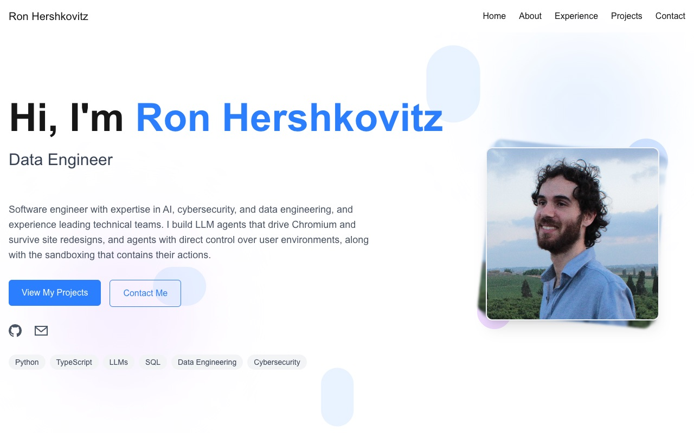

# Ron Hershkovitz — Portfolio

Personal site of Ron Hershkovitz, a software engineer working on LLM agents, browser automation and sandboxing.

**Live:** [portfolio.cloudbrainwave.com](https://portfolio.cloudbrainwave.com)



## What's on the site

- **About** — background and a grouped technical skills list
- **Projects** — [tonee](https://tonee.studio), [PraatPlugin](https://github.com/Ron-312/PraatPlugin), [Deep Search Engine](https://github.com/Ron-312/deep-search-engine) and [StockBrain](https://github.com/Ron-312/StockBrain)
- **Experience** — work history at Reflectiz
- **Contact** — a form backed by Formspree
- **Fish Frenzy** — a small Three.js game hidden behind "Wanna play a game?" in the About section

## Stack

- [Next.js 15](https://nextjs.org) (App Router, static export) with React 19 and TypeScript
- [Tailwind CSS 4](https://tailwindcss.com) for styling
- [Framer Motion](https://motion.dev) for animations
- [Three.js](https://threejs.org) for Fish Frenzy
- Hosted on [Netlify](https://www.netlify.com)

## Running locally

```bash
npm install
npm run dev
```

Then open [http://localhost:3000](http://localhost:3000).

`npm run build` writes the static site to `out/`, which is what Netlify publishes.

## Project layout

```
src/
  app/                  layout, page and global styles
  components/           one component per page section
    FishFrenzy/         the Three.js game
public/
  images/               profile photo and project logos
  gameModels/           3D models used by Fish Frenzy
```
